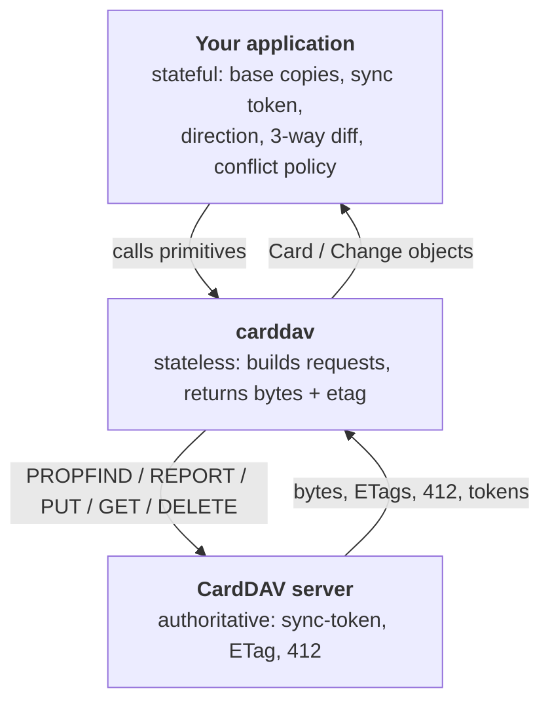

# Sync model: primitives here, engine in your app

**English** · [简体中文](sync-model.zh-CN.md)

This library does **not** sync anything. It gives you four protocol primitives and stops
there. This page explains why, and what your application has to own.

## What the protocol can actually give you

| You want | The protocol gives | This library |
|---|---|---|
| "What is in this address book?" | `PROPFIND Depth: 1` | `get_cards()` |
| "What changed since last time?" | RFC 6578 `sync-collection` (href + etag, deletions as `404`) | `get_changes(sync_token)` |
| "Give me the content" | `GET` or `addressbook-multiget` | `get_card()` / `multiget()` / `get_all_cards()` |
| "Write it, but fail if someone else changed it" | `PUT` + `If-Match` → `412` | `put_card(if_match=...)` |

That is the whole vocabulary. There is no "direction", no field-level diff, no merge, and
no reliable tombstone guarantee after a token expires. Deciding *who wins* is a product
decision, so it lives in your code.

## Three layers, three kinds of memory

## What "stateless" means here

`DAVClient` keeps only constructor-time snapshots: the URL, the transport, the auth object.
`AddressBook` keeps its URL, optional display name and ctag. **Nothing else.**

There is no content cache, no etag cache, no token cache, no UID→href index, no local
database. Each call does: build URL → add auth → send → translate status into an exception
→ parse XML or return raw bytes → hand back a snapshot → forget everything.

The **only** exception is `Card`: it holds what the server returned, and only for as long as
you keep the object.

## What your application must persist

| Item | Why it must survive a restart | Consequence if lost |
|---|---|---|
| `uid` → `href` | `href` is arbitrary and may change; `UID` is the stable key | You cannot tell "this is the same contact" |
| `etag` (base) | Needed for `If-Match`; without it you must re-read before every write | You either overwrite blindly or waste a round trip |
| **raw bytes (base)** | The only way to know whether *you* changed the card | You cannot distinguish "remote changed" from "both changed" |
| `sync_token` | Turns a full listing into a delta | Every run re-downloads everything |
| Conflict policy | Decisions can't be inferred from data | Silent data loss on the first real conflict |

Only storing `href` + `etag` gets you a **one-way mirror**. You need the base bytes before
you can honestly call it two-way.

## The three-way decision

`base` = the bytes and etag you recorded at the end of the last successful sync.
"Changed" is whatever comparison your app defines (bytes, normalized fields, `REV`).

| base | local | remote | Meaning | Action |
|---|---|---|---|---|
| — | yes | — | new locally | `put_card(create_only=True)` |
| — | — | yes | new remotely | fetch it |
| yes | changed | unchanged | local edit | `put_card(href=base.href, if_match=base.etag)` |
| yes | unchanged | changed | remote edit | fetch it |
| yes | changed | changed, same bytes | both converged | update base only |
| yes | changed | changed, different | **real conflict** | apply your policy |
| yes | deleted | unchanged | local delete | `delete_card(href, if_match=base.etag)` |
| yes | unchanged | deleted | remote delete | delete locally |
| yes | deleted | changed | **delete/edit conflict** | keep remote + keep a local copy |

## Four pitfalls that break naive implementations

1. **`href` is not identity, `UID` is.** Aligning on `href` turns one contact into
   "delete + add" whenever the server renames a resource.
2. **Update must `PUT` back to the original `href`.** Deriving `<uid>.vcf` again can create
   a *second* card (lenient servers keep both; sabre/dav rejects with `no-uid-conflict`).
   Use `put_card(..., href=card.href)`.
3. **Servers rewrite.** Radicale sets `UID` from the file name (see
   [quirks.md](quirks.md) §2). Always store the response as the new base.
4. **Deletes are permanent and unreliable.** After a `sync-token` expires there is no
   tombstone; a full re-list cannot distinguish "deleted remotely" from "never synced".

## Conflict policies you can pick from

| Policy | Behaviour | Fits |
|---|---|---|
| Server wins | remote always overwrites local | one-way mirror, read-mostly |
| Local wins | local always overwrites remote | migrations, initial seeding |
| Field merge | parse both, merge, `PUT` the **whole** card back | shared address books |
| Conflict copy | keep both, `<uid>-conflict-…` | never lose data, tolerate duplicates |

There is no field-level write in CardDAV: merging means computing the merged vCard yourself
and putting the entire resource back.

## What this library gives — and refuses to give

**Gives:** discovery, listing, content, conditional write, delete, incremental changes,
server-side search (raw XML), and a CLI export.

**Refuses:** vCard parsing, field comparison, deduplication, merge, conflict resolution,
local storage, UID generation.

The rationale for drawing the boundary here — what was considered and rejected — is kept
in the maintainers' notes inside this repository.
