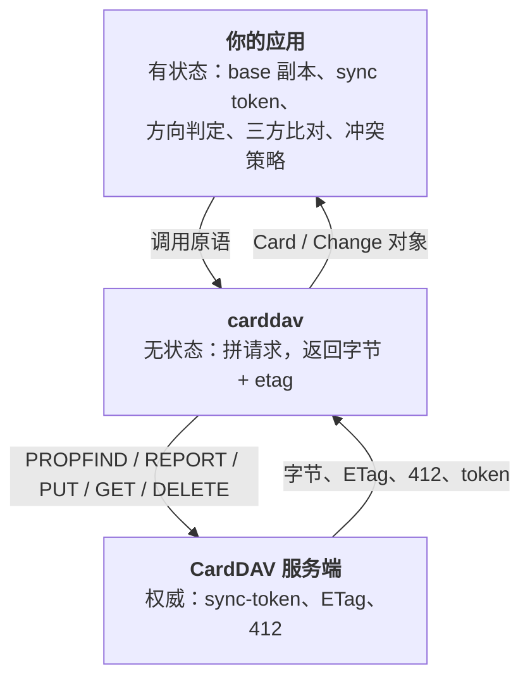

# 同步模型：原语在库里，引擎在应用里

[English](sync-model.md) · **简体中文**

本库**不做**任何同步。它只提供四个协议原语，然后就停手。本页解释为什么，以及你的应用必须自己承担什么。

## 协议实际能给什么

| 你想要 | 协议给的 | 本库 |
|---|---|---|
| 「这个地址簿里有什么」 | `PROPFIND Depth: 1` | `get_cards()` |
| 「上次之后变了什么」 | RFC 6578 `sync-collection`（href + etag，删除以 `404` 表示） | `get_changes(sync_token)` |
| 「把内容给我」 | `GET` 或 `addressbook-multiget` | `get_card()` / `multiget()` / `get_all_cards()` |
| 「写进去，但别人改过就失败」 | `PUT` + `If-Match` → `412` | `put_card(if_match=...)` |

词表就这些：没有「方向」、没有字段级 diff、没有合并，token 过期后也没有可靠的墓碑（删除记录）。
「谁赢」是产品决策，所以它必须留在你的代码里。

## 三层与三份「记忆」

## 这里的「无状态」是什么意思

`DAVClient` 只保留构造期的快照：URL、transport、auth 对象。`AddressBook` 只保留自己的 URL、
可选的显示名与 ctag。**别的什么都不留。**

没有内容缓存、没有 etag 缓存、没有 token 缓存、没有 UID→href 索引、没有本地数据库。
一次调用就是：拼 URL → 加鉴权 → 发送 → 把状态码翻译成异常 → 解 XML 或取原始字节 →
返回一个快照 → 忘掉。

**唯一**的例外是 `Card`：它持有服务端返回的内容，且只在你保留这个对象期间存在。

## 你的应用必须持久化什么

| 项 | 为什么必须跨重启保留 | 丢了会怎样 |
|---|---|---|
| `uid` → `href` | `href` 任意且可能变；`UID` 才是稳定键 | 认不出「这是同一个联系人」 |
| `etag`（base） | `If-Match` 需要它；没有就得每次写前重读 | 要么盲写覆盖，要么白白多一次往返 |
| **原始字节（base）** | 唯一能判断「是**我**改了」的依据 | 分不清「远端改了」与「双方都改了」 |
| `sync_token` | 把全量列举变成增量 | 每次运行都重新下载全部 |
| 冲突策略 | 无法从数据里推断出来 | 第一次真冲突就静默丢数据 |

只存 `href` + `etag` 得到的是**单向镜像**。要诚实地叫「双向」，必须存 base 字节。

## 三方比对

`base` = 上次同步成功时记录的字节与 etag。「改没改」由你的应用定义（字节、规范化字段集、`REV` 均可）。

| base | 本地 | 远端 | 含义 | 动作 |
|---|---|---|---|---|
| 无 | 有 | — | 本地新增 | `put_card(create_only=True)` |
| 无 | — | 有 | 远端新增 | 拉取 |
| 有 | 改 | 未改 | 本地改 | `put_card(href=base.href, if_match=base.etag)` |
| 有 | 未改 | 改 | 远端改 | 拉取 |
| 有 | 改 | 改（字节相同） | 双方收敛 | 只更新 base |
| 有 | 改 | 改（字节不同） | **真冲突** | 按你的策略 |
| 有 | 删 | 未改 | 本地删 | `delete_card(href, if_match=base.etag)` |
| 有 | 未改 | 删 | 远端删 | 删本地 |
| 有 | 删 | 改 | **删改冲突** | 保留远端 + 本地留副本 |

## 四个会让朴素实现翻车的坑

1. **`href` 不是身份，`UID` 才是。** 按 `href` 对齐时，服务端改名会把一张卡变成「删一张 + 加一张」。
2. **更新必须 `PUT` 回原 `href`。** 重新推导 `<uid>.vcf` 可能**新建第二张卡**（宽容的服务端两张并存，
   sabre/dav 用 `no-uid-conflict` 拒绝）。用 `put_card(..., href=card.href)`。
3. **服务端会改写。** Radicale 会用文件名重设 `UID`（见 [quirks.zh-CN.md](quirks.zh-CN.md) 第 2 条）。
   永远把响应当作新 base。
4. **删除是永久的，而且不可靠。** `sync-token` 过期后没有墓碑；全量重列无法区分「远端删了」与「从未同步过」。

## 可选的冲突策略

| 策略 | 行为 | 适合 |
|---|---|---|
| 服务端优先 | 远端永远覆盖本地 | 单向镜像、以读为主 |
| 本地优先 | 本地永远覆盖远端 | 迁移、首次灌数据 |
| 字段级合并 | 解析两边 → 合并 → 把**整张卡** PUT 回去 | 共享地址簿 |
| 冲突副本 | 两份都留，`<uid>-conflict-…` | 绝不丢数据，可接受重复 |

CardDAV 没有字段级写入：所谓合并，就是你自己算出合并后的 vCard，再整卡写回。

## 本库给什么、不给什么

**给**：发现、列举、取内容、条件写、删除、增量、服务端搜索（原文 XML）、CLI 导出。

**不给**：vCard 解析、字段比较、去重、合并、冲突解决、本地存储、UID 生成。

边界为什么这么划（以及考虑过但否掉的方案）保存在仓库内的维护者笔记里。
